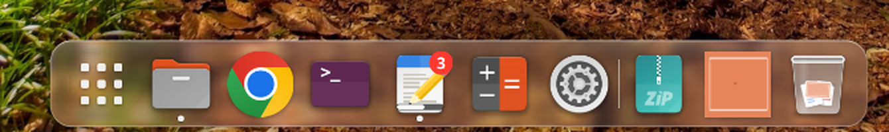
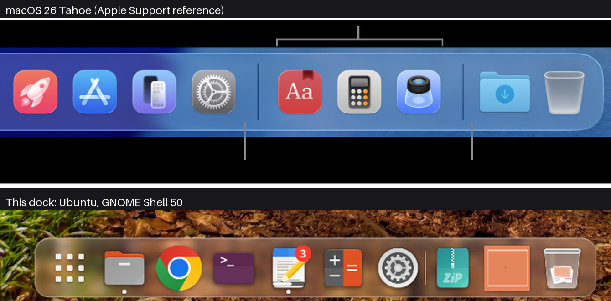
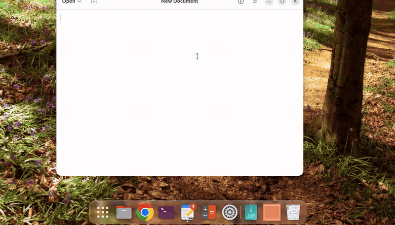

# ubuntu-tweaks

My personal Ubuntu (GNOME, Wayland) tweaks.

## Install

Fresh machine:

```sh
gh repo clone alex-mextner/.files ~/.files        # your private profile (optional)
git clone --recurse-submodules https://github.com/alex-mextner/ubuntu-tweaks ~/xp/ubuntu-tweaks
~/xp/ubuntu-tweaks/bin/ubuntu-tweak init           # preview: doctor, submodules, CLI link, plan
~/xp/ubuntu-tweaks/bin/ubuntu-tweak init --commit  # do it
```

Then log out and back in (the Shell on Wayland loads extension code only at login). Repo
extensions, including the dock submodule, are symlinked into
`~/.local/share/gnome-shell/extensions`, so the repo stays the source of truth. Re-running is safe.
`./install.sh` still works: it is `bin/ubuntu-tweak init --commit`; a non-interactive run needs
`--yes` to install missing apt packages (`./install.sh --yes`).

Upgrading a clone from before the dock rename (submodule path
`gnome-extensions/dash2dock-lite@icedman.github.com` → `gnome-extensions/hyperdock`):
`git pull && ubuntu-tweak apply --commit`. `apply` initializes the submodule at its new path and
replaces the old extension link. Git leaves the old submodule directory behind; remove it once
nothing unpushed is left in it. `status` reports the old
`dash2dock-lite@icedman.github.com` extension as an *Extra* until the hyperdock migration has
moved its settings.

## `ubuntu-tweak` CLI

`bin/ubuntu-tweak` is the umbrella CLI described in
[`docs/specs/ubuntu-tweak-cli.md`](docs/specs/ubuntu-tweak-cli.md): the modules of this repo plus a
private settings profile (default `~/.files/ubuntu`, override with `--profile DIR` or
`$UBUNTU_TWEAK_PROFILE`; per-machine overlay named by `/etc/hostname` or `--machine`). Every
mutating command previews first and changes nothing without `--commit`.

| Command | What it does |
|---|---|
| `init [--commit]` | fresh system: `doctor`, submodules, CLI link in `~/.local/bin`, then `apply`; preview without `--commit` |
| `apply [--commit] [--no-sudo]` | print the plan (what would change), or run it; a second run says `0 changed` |
| `status` | Missing / Modified / Extra; exit 3 when anything declared is missing or modified |
| `update [--commit]` | `git pull --ff-only`, update submodules, then `apply` |
| `doctor [--yes]` | check `python3-gi`, `dconf-cli`, `git`, `glib-compile-schemas` and module deps; `--yes` installs them |
| `list`, `machine` | read-only: modules (kind, enabled, source); machine overlay and where each setting comes from |
| `capture [--commit] [--dry-run] [--summary] [--report FILE] [--only …] [-v]` | read-only inventory of the live system, printed as the exact diff the profile would get (SUMMARY block first; `--dry-run` is the explicit no-write mode, `--summary` prints only the summary); `--commit` writes it into the profile working tree (never runs git) |
| `bundles [--show NAME]` | read-only: the settings bundles, where each applies, shadowed / duplicated / conflicting keys |
| `bundle-move <bundle> <key-or-glob>... [--commit]` | group keys (with their comments) into one bundle; preview by default |
| `note <bundle>:<key> "reason" [--commit]` | add, change or remove the reason of a setting (also `packages:apt:<name>`, `system:<key>`) |

Modules live in `modules/<name>/module.toml`: `hyperdock` (submodule), `english-in-overview`
(local extension); `memguard` and `apple-hid-battery` are root-level `system` modules.
Tests: `scripts/ci.sh`; the end-to-end check on a scratch dconf and HOME is `scripts/integration.sh`
(module preset, two settings bundles with reasons, machine overlay, linked files, `capture` preview; it never
touches your dconf).

### Settings workflow: preview → commit → review → PR

What you configure in GNOME Settings (and the config files you keep under `~/.config`) lives in the
private profile, `~/.files/ubuntu` (`settings/**/*.ini` bundles, `files/`, `packages.toml`,
`system.toml`, and `machines/<hostname>/` for what differs per machine). The engine here holds no
personal data.

```sh
ubuntu-tweak capture                  # 1. preview: exactly what the profile would receive (+ new, ~ differs, = same)
ubuntu-tweak capture --commit         # 2. write it into ~/.files/ubuntu (no git commit, secrets refuse the write)
git -C ~/.files diff                  # 3. second look, then commit and open a PR in .files
ubuntu-tweak apply                    # 4. on any machine: preview what would change
ubuntu-tweak apply --commit           # 5. do it; `status` reports drift, a second run says `0 changed`
```

`capture --commit` replaces each adopted file by a symlink into the profile (the original is copied to
`~/.local/state/ubuntu-tweaks/backup/<UTC timestamp>/` first); `apply` links the same files on another
machine. Keys that only make sense for one machine (power, touchpad, monitors) are captured into
that machine's overlay.

#### Bundles and reasons

Any `settings/**/*.ini` file in the profile is a *bundle*: a keyfile named by purpose
(`dev-keyboard`, `laptop/power`) that may hold keys from any dconf path, merged with the others at
load (the idea is Home Assistant's `packages:`). `machines/<hostname>/settings/**/*.ini` are bundles
too and win key by key. The same key with different values in two bundles of one layer is an error
(exit 2, both files and lines named); identical values only warn.

```ini
[ubuntu-tweak]                         # optional header, not a dconf section
description = "Keys for the dev keyboard"
machines = ["home"]                    # apply only on these hostnames (also: requires-module = "hyperdock")

[org/gnome/desktop/wm/keybindings]
# Super+arrows belong to the tiler, so workspaces move on Alt   <- the reason: comments above a key
switch-to-workspace-left=['<Super><Alt>Left']
```

`apply` prints the reason next to each key, `status` shows it for modified keys, and `capture --commit`
rewrites only changed values, keeping every comment and the file's order. Capture puts a new key where
the profile already holds it, else into the bundle that `[capture.bundles]` in `profile.toml` routes it
to, else into the panel's own file:

```toml
# profile.toml
[capture.bundles]                      # first matching entry wins
"dev-keyboard" = ["org/gnome/desktop/wm/keybindings/**", "org/gnome/shell/extensions/tiling-assistant/**"]
"laptop/power" = ["org/gnome/settings-daemon/plugins/power/**"]
```

`packages.toml` keeps reasons too (`"tmux",  # shell tools`; `note packages:apt:tmux "reason"`) and takes
two optional keys: `flatpak_remote = "flathub"` (the remote flatpaks install from) and
`apt_update = true` (run `apt-get update` before the apt batch).

```sh
ubuntu-tweak bundles                   # list bundles, what applies here, shadowed / duplicated / conflicting keys
ubuntu-tweak bundles --show dev-keyboard   # the merged result of one bundle
ubuntu-tweak bundle-move dev-keyboard 'org/gnome/desktop/wm/keybindings/**'   # group keys (preview; --commit writes)
ubuntu-tweak note dev-keyboard:org/gnome/desktop/wm/keybindings/close "why"   # add a reason (also packages:apt:<name>)
ubuntu-tweak capture --dry-run         # the explicit no-write preview, SUMMARY block first (--summary: only that)
```

Only values you changed are captured (never schema defaults), and keys the system or an app registered
by itself (notification app ids, Ptyxis profile uuids, portal shortcuts, input-source MRU order, ...) are
listed in their own `auto` section instead; `[capture] include = ["org/gnome/..."]` promotes any of them.

## Tweaks

| Tweak | Path | What it does |
|---|---|---|
| English in Overview | `gnome-extensions/english-in-overview@ultra` | Switches the keyboard layout to `us` whenever the launcher (Super / Activities) opens. GNOME Shell 50. |
| macOS dock (`hyperdock`) | `gnome-extensions/hyperdock` (submodule), `modules/hyperdock/` | macOS 26-style dock replacing Ubuntu Dock: Liquid Glass with adaptive contrast, glass Trash showing its contents, stacks, badges, genie minimize, drag and drop. Spec: [`docs/specs/mac-dock.md`](docs/specs/mac-dock.md). Presets in `modules/hyperdock/dock.ini` (enforced by `apply`); the Screenshots stack is seeded once. |
| memguard swap drain | `modules/memguard/` (root: `sudo modules/memguard/install.sh`, `--dry-run` shows the diff) | Folds stale swap back into RAM when RAM can take it: one device at a time, aborted if memory turns tight. A 10-min timer decides (most runs skip with a logged reason); on demand: `memguard swap-drain` (no password). Publishes `/run/memguard/swap-drain.json` so gates can ignore a drain's 0 % SwapFree. Spec: [`docs/specs/memguard.md`](docs/specs/memguard.md) § Swap hygiene. |

## macOS dock



macOS 26 Tahoe (top) and this dock (bottom):



*Top: Apple, macOS 26 Dock — screenshot from [Apple Support](https://support.apple.com/guide/mac-help/open-apps-from-the-dock-mh35859/26/mac/26), used for comparison.*

| Screenshots stack: glass popover with a notch at the icon | Glass Trash: empty, a few items, many items |
|---|---|
|  |  |



- **Liquid Glass** platter; separators and dots adapt their contrast to the wallpaper.
- **Glass Trash** that shows how full it is and thumbnails of the newest items.
- **Stacks:** Downloads and Screenshots by default; Fan, Grid or List; sort and display
  from the stack's right-click menu.
- **Badges and progress** from apps (Unity LauncherEntry: Telegram, Thunderbird, downloads)
  and red notification counts.
- **Genie minimize** into a tile of the window before Trash, as on macOS (own GPU
  effect); clicking the tile restores the window out of it. Launch and attention bounces.
- **Drag and drop:** drag an icon off the dock to remove it; drop files onto Trash to
  trash them, onto an app to open them with it, or onto a stack to move or copy them
  there.
- **Super+Alt+D** toggles auto-hide; right-click the dock background for hiding,
  magnification, position and settings.
- **Show All Windows** of an app from its menu; **recent apps** after the running ones.

Built on [Dash2Dock Animated](https://github.com/icedman/dash2dock-lite); the code lives in
[`alex-mextner/hyperdock`](https://github.com/alex-mextner/hyperdock) (branch `mac-tahoe`).
Everything is a setting: open the extension's *Settings* in the Extensions app.

- **Folder stacks:** *Others → Folder Stacks* adds any folder next to Downloads, or set
  it directly:
  `dconf write /org/gnome/shell/extensions/dash2dock-lite/folder-stacks "'[\"~/Projects\", {\"path\": \"~/Pictures/Screenshots\", \"icon\": \"folder-pictures\"}]'"`
- **Back to Ubuntu Dock:** `gnome-extensions disable <hyperdock uuid>` (the uuid is in
  `gnome-extensions/hyperdock/metadata.json`) and remove `ubuntu-dock@ubuntu.com` from
  `/org/gnome/shell/disabled-extensions`; set `[modules.hyperdock] enabled = false` in your profile
  so `ubuntu-tweak apply` stops managing it.

## Uninstall a GNOME extension

```sh
gnome-extensions disable <uuid>
rm -r ~/.local/share/gnome-shell/extensions/<uuid>
```
